<div align="center">


# FitLog

**Antrenman, beslenme ve vücut gelişimini tek yerden takip eden full-stack fitness uygulaması**

[](https://dotnet.microsoft.com/)
[](https://react.dev/)
[](https://www.typescriptlang.org/)
[](https://vite.dev/)
[](https://www.postgresql.org/)
[](#)
[](LICENSE)

🌐 **Canlı:** [emirkoroglu.online](https://www.emirkoroglu.online)

[Özellikler](#-özellikler) • [Ekran Görüntüleri](#-ekran-görüntüleri) • [Teknolojiler](#-teknolojiler) • [Kurulum](#-kurulum) • [API](#-api-endpoints)

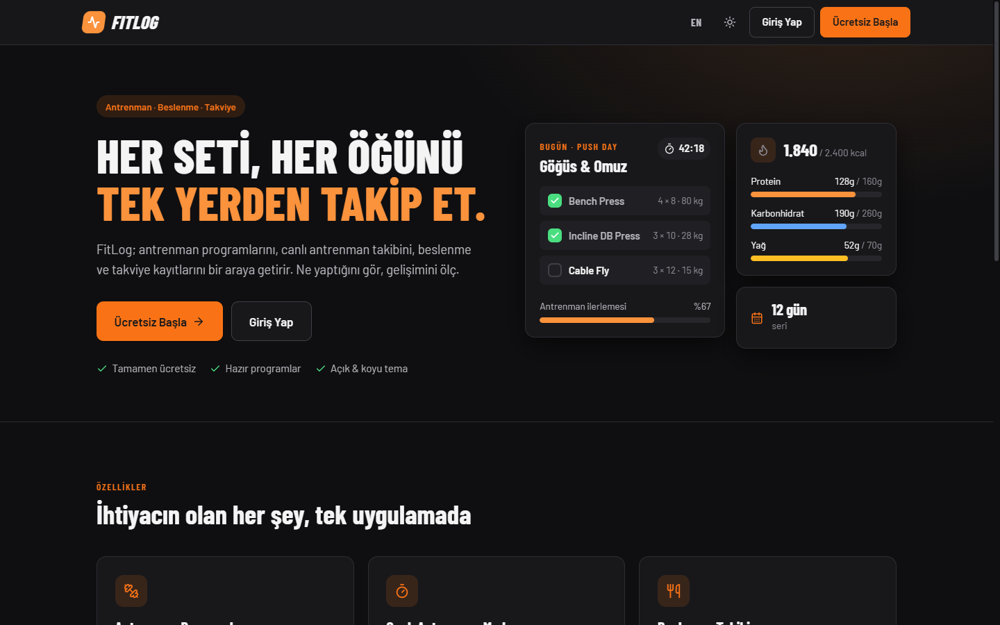

</div>

---

## 📖 Proje Hakkında

FitLog; antrenman programlarını, canlı antrenman takibini, beslenme, su ve takviye kayıtlarını, vücut ölçülerini ve hedefleri tek bir uygulamada toplar. Backend **ASP.NET Core 9** ile Clean Architecture'a göre katmanlara ayrılmıştır. Frontend **React + TypeScript** ile yazılmış, telefona kurulabilen (PWA), açık/koyu temalı ve Türkçe/İngilizce bir arayüzdür.

Uygulama yayında: API **Render** (Docker), veritabanı **Neon** (PostgreSQL), arayüz **Vercel** üzerinde çalışıyor.

---

## ✨ Özellikler

### 🏋️ Antrenman
- **Kas haritası:** Seçili programa göre insan vücudu üzerinde hangi kasın haftada kaç set çalıştığı ısı haritası olarak görünür.
- **Programlar:** Push/Pull/Legs, Full Body, Upper/Lower gibi 16 hazır şablon ya da sıfırdan kendi programın.
- **Sürükle-bırak:** Egzersizleri sürükleyerek sıralayabilir, yeniden adlandırabilirsin.
- **Süperset:** İki egzersizi tek dokunuşla birbirine bağlarsın.
- **Egzersiz kütüphanesi:** 190+ egzersiz, yazım hatalarını ve takma adları tolere eden arama, "nasıl yapılır" açıklamaları.
- **Canlı antrenman modu:** Set kaydı, dinlenme sayacı, plaka hesaplayıcı, ısınma setleri ve RPE.
- **İlerleme önerisi:** Geçen seansa bakıp "bu sefer +2,5 kg dene" gibi öneri verir.
- **Kardiyo kaydı:** Mesafe, hız, eğim ve nabız girersin, yakılan kalori tahmin edilir.

### 🥗 Beslenme
- **Yiyecek veritabanı:** 160+ Türk ve dünya yemeği (et sote, tavuk sote, çorbalar, tatlılar…), yine hataya toleranslı aramayla.
- **Barkod okuma:** Kamerayla barkodu okutunca ürünün değerleri Open Food Facts'ten gelir.
- **Öğün şablonları ve kopyalama:** Sık yediğin öğünleri şablon olarak kaydeder, önceki günü tek tıkla kopyalarsın.
- **Makro takibi:** Kalori, protein, karbonhidrat ve yağ için hedef çubukları.
- **Akıllı öneri:** Kalan kalori ve proteine göre ne yiyebileceğini önerir.
- **Takviye kontrol listesi:** Günlük takviyelerini işaretlersin, besin değerleri günlük toplama eklenir.

### 📊 Takip & Analiz
- **İlerleme grafikleri:** Egzersiz bazında tahmini 1RM, en ağır set ve hacim; haftalık hacim ve kişisel rekorlar.
- **Takvim ve seri:** Antrenman takvimi ve günlük seri (streak) takibi.
- **Vücut ölçüleri:** Kilo, çevre ölçüleri, otomatik yağ oranı tahmini ve ilerleme fotoğrafları.
- **Su takibi:** Panelden tek dokunuşla bardak ekleme.
- **Hesaplayıcılar ve yakılan kalori:** BMI/BMR, 1RM ve günlük yakılan kalori tahmini.
- **AI Koç:** Verilerine bakarak kişisel öneriler veren koç.

### 🏆 Motivasyon & Deneyim
- **Rozetler ve hedefler:** 26 başarı rozeti, hedef belirleme ve takibi.
- **İlk giriş turu:** Yeni kullanıcıya uygulamayı adım adım gösteren rehber kartlar.
- **Platform:** Açık/koyu tema, TR/EN dil desteği, telefon ve tablet uyumlu PWA.
- **Güncelleme bildirimi:** Yeni sürüm yayınlanınca kullanıcıya haber verir.
- **Admin paneli:** Kullanıcı istatistikleri, hesap kilitleme ve şifre sıfırlama.

---

## 📸 Ekran Görüntüleri

| Panel | Antrenmanlar & Kas Haritası |
|:---:|:---:|
| 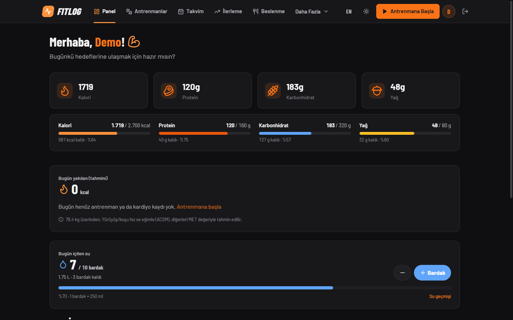 | 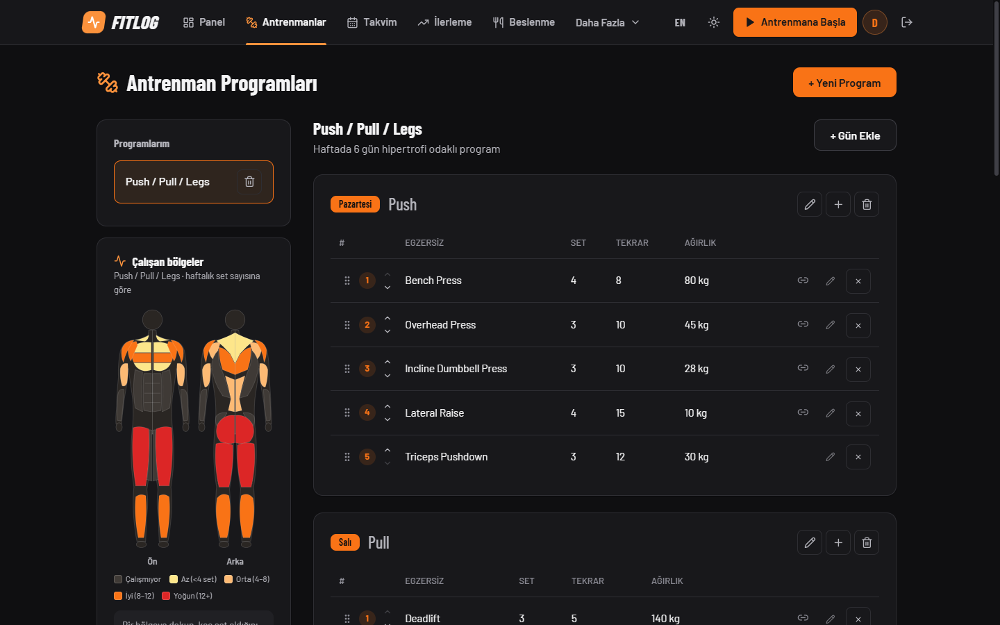 |
| **Canlı Antrenman Modu** | **İlerleme** |
| 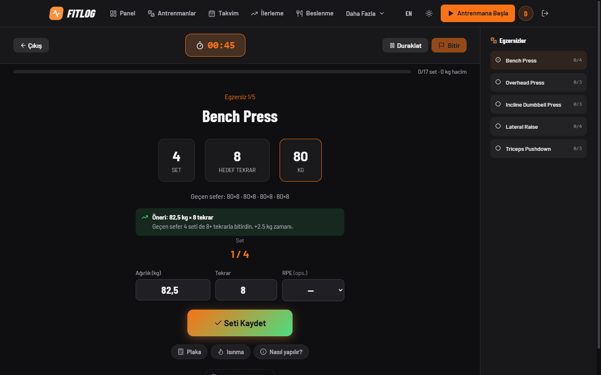 | 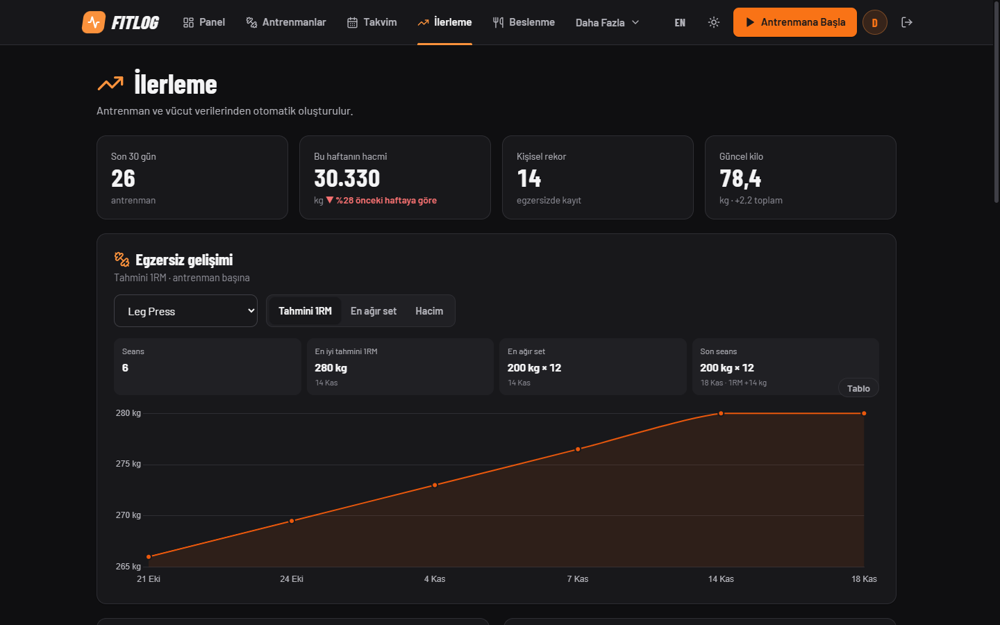 |
| **Beslenme** | **Takvim** |
| 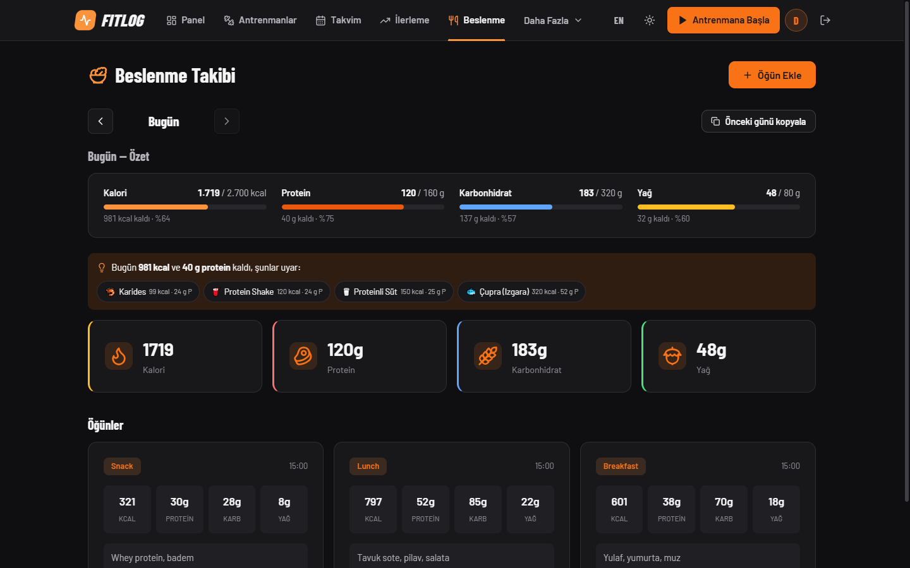 | 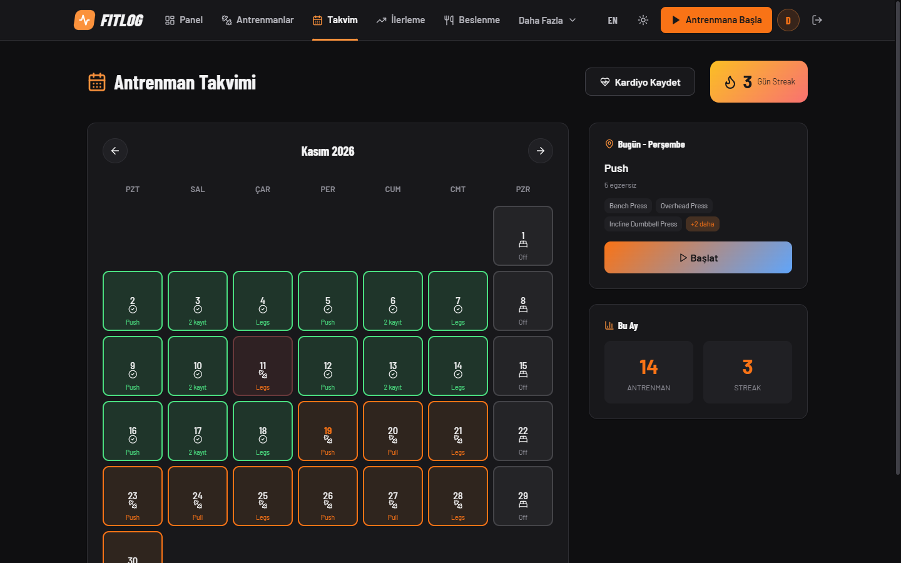 |
| **Vücut Ölçüleri** | **Başarılar** |
| 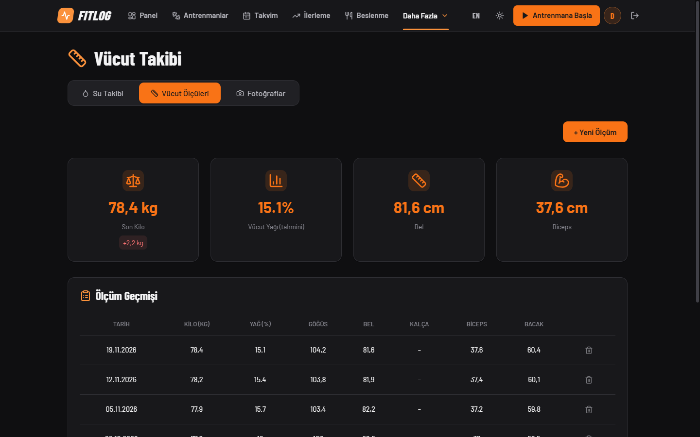 | 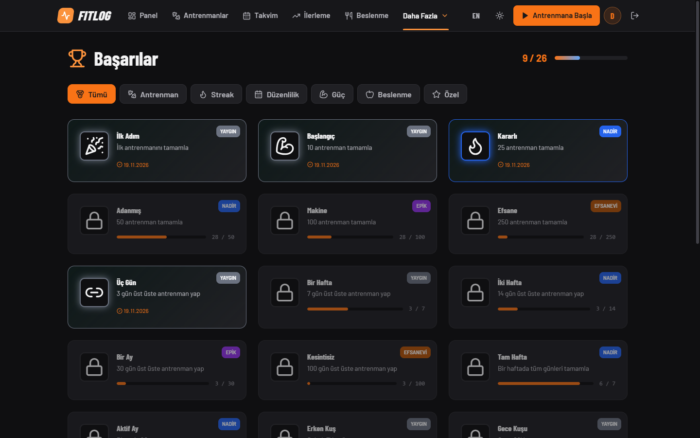 |

<div align="center">

**Mobil: ilk giriş turu ve kas haritası (açık tema)**

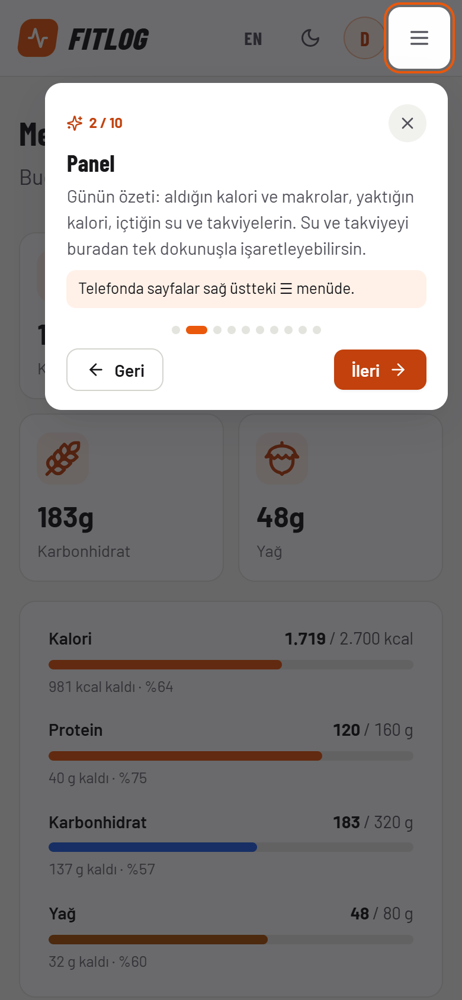&nbsp;&nbsp;&nbsp;
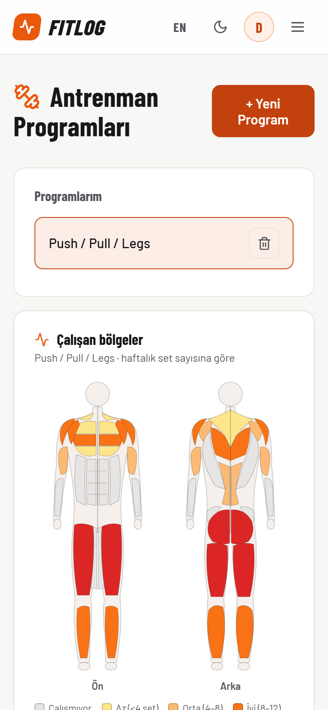

</div>

---

## 🛠 Teknolojiler

### Backend
| Teknoloji | Açıklama |
|-----------|----------|
| .NET 9 / ASP.NET Core | Web API |
| Entity Framework Core 9 + Npgsql | ORM, PostgreSQL |
| ASP.NET Identity + JWT | Kimlik doğrulama, refresh token |
| FluentValidation | İstek doğrulama |
| Resend | Şifre sıfırlama e-postaları |
| OpenAI API | AI Koç analizleri |
| Swagger / OpenAPI | API dokümantasyonu |

### Frontend
| Teknoloji | Açıklama |
|-----------|----------|
| React 19 + TypeScript 5.9 | UI |
| Vite 7 | Build aracı |
| React Router 7 | Yönlendirme |
| Chart.js | Grafikler |
| ZXing | Barkod okuma |
| Lucide | İkonlar |
| PWA (manifest + service worker) | Telefona kurulum |

### Altyapı
| Servis | Kullanım |
|--------|----------|
| Render (Docker) | API |
| Neon | PostgreSQL |
| Vercel | Frontend |

### Mimari
```
┌─────────────────────────────────────────────────────────────┐
│  API Layer             Controllers, Middleware, Auth         │
├─────────────────────────────────────────────────────────────┤
│  Application Layer     DTOs, Service interfaces, Validators │
├─────────────────────────────────────────────────────────────┤
│  Infrastructure Layer  DbContext, Migrations, Services,     │
│                        Identity, OpenAI, Email              │
├─────────────────────────────────────────────────────────────┤
│  Domain Layer          Entities                             │
└─────────────────────────────────────────────────────────────┘
```

---

## 🚀 Kurulum

### Gereksinimler
- [.NET 9 SDK](https://dotnet.microsoft.com/download)
- [Node.js 20+](https://nodejs.org/)
- PostgreSQL 14+ (yerelde ya da Docker ile)

### 1. Projeyi klonla
```bash
git clone https://github.com/EmirKoroglu3/FitLog.git
cd FitLog
```

### 2. Veritabanı (Docker ile hızlı yol)
```bash
docker run -d --name fitlog-pg -p 5432:5432 -e POSTGRES_PASSWORD=postgres -e POSTGRES_DB=fitlog postgres:16-alpine
```

### 3. Backend
```bash
cp FitLog.API/appsettings.Development.json.example FitLog.API/appsettings.Development.json
# appsettings.Development.json içinde bağlantı cümlesini ve JWT Secret'ı (min 32 karakter) düzenle

dotnet restore
dotnet ef database update --project FitLog.Infrastructure --startup-project FitLog.API
dotnet run --project FitLog.API --launch-profile http
```

### 4. Frontend
```bash
cd fitlog-ui
cp .env.example .env
npm install
npm run dev
```

### 5. Erişim
| Servis | URL |
|--------|-----|
| Frontend | http://localhost:5173 |
| Backend API | http://localhost:5001 |
| Swagger UI | http://localhost:5001/swagger |

Production kurulumu (Render + Neon + Vercel) için [DEPLOY.md](DEPLOY.md) dosyasına bakın.

---

## 📁 Proje Yapısı

```
FitLog/
├── FitLog.Domain/           # Entity'ler
├── FitLog.Application/      # DTO'lar, servis arayüzleri, validator'lar
├── FitLog.Infrastructure/   # DbContext, migration'lar, servisler, Identity, OpenAI
├── FitLog.API/              # Controller'lar, middleware
├── fitlog-ui/               # React + TypeScript (Vite)
│   └── src/
│       ├── components/      # Kas haritası, barkod okuyucu, tur, grafikler…
│       ├── data/            # Egzersiz, yiyecek, takviye ve şablon veritabanları
│       ├── pages/           # Sayfalar
│       ├── services/        # API servisleri
│       └── store/           # Auth, tema, ayarlar context'leri
├── docs/screenshots/        # README görselleri
├── Dockerfile               # API imajı
└── render.yaml              # Render blueprint
```

---

## 🔌 API Endpoints

Tüm uç noktalar `/api` altındadır; ayrıntılar Swagger'da.

| Alan | Uç noktalar |
|------|-------------|
| Auth | `POST auth/register` · `auth/login` · `auth/refresh` · `auth/forgot-password` · `auth/reset-password` |
| Programlar | `workout/programs` · `workout/days` · `workout/exercises` · `PUT workout/days/{id}/exercise-order` |
| Seanslar | `sessions` · `sessions/exercise-history` · `sessions/weekly-volume` · `sessions/personal-records` |
| Beslenme | `nutrition` · `nutrition/summary` · `meal-templates` · `foods/custom` |
| Takviye | `supplement` · `supplement-intake/{id}/{date}` |
| Vücut | `body/measurements` · `body/water/{date}` · `body/photos` |
| Hedefler | `goals` · `goals/one-rep-max` |
| Profil & Ayarlar | `profile` · `profile/analysis` · `settings` |
| AI Koç | `POST aicoach/analyze` |
| Admin | `admin/stats` · `admin/users` · `admin/users/{id}/lock` · `unlock` · `password-reset` |

---

## 📝 Lisans

MIT lisansı altındadır. Ayrıntılar için [LICENSE](LICENSE).

## 👤 Geliştirici

**Emir Köroğlu**

[](https://github.com/EmirKoroglu3)
[](https://linkedin.com/in/emir-koroglu)

<div align="center">

⭐ Projeyi beğendiyseniz yıldız vermeyi unutmayın!

</div>
